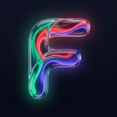

# Fluo — Intelligent Personal Finance & Wealth Tracker

<div align="center">



**Fluo** es una aplicación de finanzas personales y gestión patrimonial *Mobile-First*, concebida con los más exigentes estándares de fidelidad visual, rendimiento interactivo a 60/120 fps y privacidad absoluta. Diseñada bajo la filosofía de diseño **Liquid Glass** (inspirada en la API nativa de iOS 26+ y trasladada a la web moderna con Tailwind CSS v4 y CSS3), Fluo combina control exhaustivo del flujo de caja, seguimiento de carteras de inversión multiactivo con cotizaciones en vivo y automatización inteligente descentralizada.

[](https://react.dev/)
[](https://www.typescriptlang.org/)
[](https://vitejs.dev/)
[](https://tailwindcss.com/)
[](https://supabase.com/)
[](https://web.dev/progressive-web-apps/)
[](https://vitest.dev/)
[](LICENSE)

</div>

---

## 📑 Tabla de Contenidos
1. [Propuesta de Valor & Características Principales](#-propuesta-de-valor--características-principales)
2. [Arquitectura y Stack Tecnológico](#-arquitectura-y-stack-tecnológico)
3. [Sistema de Diseño: Liquid Glass](#-sistema-de-diseño-liquid-glass)
4. [Ciberseguridad, Criptografía y Privacidad](#-ciberseguridad-criptografía-y-privacidad)
5. [Guía de Instalación y Desarrollo Local](#-guía-de-instalación-y-desarrollo-local)
6. [Despliegue en Producción (Vercel & PWA)](#-despliegue-en-producción-vercel--pwa)
7. [Estructura del Proyecto & Wiki Interna](#-estructura-del-proyecto--wiki-interna)

---

## 🚀 Propuesta de Valor & Características Principales

### 1. Gestión Integral de Flujo de Caja
- **Triple Pilar Financiero**: Segmentación instantánea entre **Ingresos**, **Gastos** e **Inversiones** con balance neto unificado y cálculo reactivo de tasa de ahorro mensual.
- **Directorio de Marcas (120+ comercios offline + 25M+ globales en vivo)**: Asignación automática de identidad corporativa en comercios cotidianos (Mercadona, Carrefour, Netflix, Spotify, DAZN, Amazon, Uber, Repsol, etc.).
- **Resolución Vectorial Multi-CDN sin Distorsión**: Motor cascada en [`brandLogo.ts`](file:///c:/Users/santi/Documents/UNI/Fluo/src/utils/brandLogo.ts) que prioriza logotipos vectoriales oficiales SVG (`SimpleIcons`, `WorldVectorLogo`, `unavatar`) eliminando artefactos o halos blancos.
- **Acciones Rápidas Gestuales (Swipe Bidireccional)**:
  - **Deslizar a la derecha**: Revela una superficie Liquid Glass índigo para editar el movimiento pre-cargado.
  - **Deslizar a la izquierda**: Revela una superficie rojo coral para eliminar el registro con confirmación visual.
  - Botones de acción rápida por *hover* para uso eficiente en ordenadores de sobremesa.

### 2. Motor de Recurrencias Automático Descentralizado
- **Automatización en Cliente (`recurringEngine.ts`)**: Genera cobros y pagos programados (nóminas, suscripciones, hipotecas, aportaciones DCA) de manera autónoma, sin requerir infraestructura externa de servidores o tareas cron permanentes.
- **Calendar Clamping Inteligente**: Adaptación matemática de fechas límite para meses cortos (por ejemplo, pagos el día 31 procesados correctamente el día 28/29 de febrero o el 30 de abril).
- **Catch-up Histórico Idempotente**: Detección de saltos temporales tras periodos de inactividad que genera todas las transacciones vencidas evitando duplicidades mediante firmas hash idempotentes `${ruleId}_${date}`.

### 3. Cartera de Inversiones Multiactivo y Cotizaciones en Vivo
- **Soporte para 6 Clases de Activos**:
  1. Acciones bursátiles individuales (Apple, Microsoft, Santander, Tesla).
  2. ETFs cotizados (Vanguard S&P 500, MSCI World).
  3. Fondos indexados de inversión.
  4. Criptomonedas (Bitcoin, Ethereum, Solana).
  5. Renta fija y bonos soberanos/corporativos.
  6. Depósitos remunerados y cuentas de alta rentabilidad.
- **Búsqueda Semántica de Mercado (`marketDataService.ts`)**: Búsqueda asistida por ticker, código ISIN normalizado o nombre comercial de activos.
- **Cotizaciones en Tiempo Real y Caché Resiliente (SWR)**: Consulta en vivo de cotizaciones y tipos de cambio con estrategia *Stale-While-Revalidate* de 25 segundos y persistencia en memoria/disco para funcionamiento 100% offline.
- **Métricas de Rendimiento (P&L)**: Cálculo dinámico de plusvalías y minusvalías latentes en euros y porcentaje por activo y a nivel global de cartera.

### 4. Analítica Visual Avanzada
- **Visualización Declarativa con Recharts**: Adaptación personalizada de Recharts al lenguaje Liquid Glass mediante filtros translúcidos y tooltips enriquecidos.
- **Gráfico de Dona (Distribución de Gastos)**: Centro hueco con total gastado en doble tipografía y leyenda interactiva de pastillas reflectantes.
- **Barras Comparativas de Flujo de Caja**: Comparativa mensual de Ingresos (#10B981), Gastos (#EF4444) y Ahorro (#6366F1).
- **Evolución de Patrimonio Neto**: Gráfico de área suavizado con gradiente vertical semitransparente.
- **Ranking Top 5 de Marcas**: Podio de comercios con barras de progreso tricolor y avatar corporativo de marca.
- **Selector Temporal**: Segmented control con periodos (Este Mes, Mes Pasado, Últimos 3 Meses, Últimos 6 Meses, Este Año, Todo el Histórico).

### 5. Presupuestos y Portabilidad de Datos
- **Alertas Semánticas de Desvío**: Umbrales de advertencia en categorías clave con feedback cromático dinámico.
- **Exportación & Importación**: Capacidad de respaldo en formato JSON estandarizado y exportación tabular en CSV para análisis en Excel o Google Sheets.

---

## 🏛 Arquitectura y Stack Tecnológico

Fluo se estructura siguiendo el principio **Local-First con Sincronización Reactiva en la Nube (Cloud Sync)**: la aplicación siempre está disponible y operativa sin conexión a internet, sincronizándose de forma transparente en segundo plano cuando existe conectividad.

```
┌─────────────────────────────────────────────────────────────┐
│                 CAPA DE PRESENTACIÓN (UI)                   │
│        React 19 + TypeScript + Tailwind CSS v4 (Oxide)      │
│   Componentes Liquid Glass (GlassCard, GlassSelect, Dock)   │
└──────────────────────────────┬──────────────────────────────┘
                               │
┌──────────────────────────────▼──────────────────────────────┐
│                  GESTIÓN DE ESTADO (STORE)                  │
│       Zustand v5 (Middleware persist con Rehidratación)     │
│   Selectores Memoizados useShallow + Virtualización cv-auto │
└──────────────┬──────────────────────────────┬───────────────┘
               │                              │
┌──────────────▼──────────────┐┌──────────────▼───────────────┐
│       ALMACENAMIENTO        ││       INTEGRACIÓN CLOUD      │
│         LOCAL-FIRST         ││       Supabase Database      │
│   LocalStorage Persist v3   ││     PostgreSQL 15 + RLS      │
│   + Memoria SWR (Quotes)    ││   JWT Sessions + WebAuthn    │
└─────────────────────────────┘└──────────────────────────────┘
```

### Tabla de Tecnologías

| Capa | Herramienta | Propósito en Fluo |
| :--- | :--- | :--- |
| **Framework Core** | [React 19](https://react.dev/) | Arquitectura de componentes, transiciones fluidas y Suspense diferido |
| **Lenguaje** | [TypeScript 5.7+](https://www.typescriptlang.org/) | Tipado estricto extremo, contratos de datos y eliminación de errores en tiempo de compilación |
| **Bundler & Tooling** | [Vite 8](https://vitejs.dev/) | Bundler de última generación con Hot Module Replacement (HMR) sub-segundo |
| **Motor de Estilos** | [Tailwind CSS v4](https://tailwindcss.com/) | Motor Oxide, compatibilidad nativa con `@theme`, variables CSS modernas y cero runtime de estilos |
| **Gestión de Estado** | [Zustand v5](https://zustand.docs.pmnd.rs/) | Store global ligero con `persist`, rehidratación selectiva y suscripciones superficiales (`useShallow`) |
| **Base de Datos & Auth** | [Supabase](https://supabase.com/) | PostgreSQL 15, Row Level Security (RLS) multi-tenant y autenticación JWT |
| **Gráficos & Visualización** | [Recharts 2.x](https://recharts.org/) | Gráficos SVG interactivos adaptados al estándar de refracción Liquid Glass |
| **PWA & Offline** | `vite-plugin-pwa` + Workbox | Service Worker para caché de assets, soporte WebKit standalone y banners de instalación |
| **Testing Automatizado** | [Vitest 5.x](https://vitest.dev/) | Suite de pruebas unitarias ultra-rápida (23 tests cubriendo motores de recurrencias, mercado y seguridad) |
| **Iconografía** | [Lucide React](https://lucide.dev/) | Glifos vectoriales consistentes, ligeros y de alta definición |

---

## 💎 Sistema de Diseño: Liquid Glass

El lenguaje visual de Fluo se fundamenta en las especificaciones maestras de **Liquid Glass** (Skill interna `.agents/skills/swiftui-liquid-glass/`), replicando en la web el comportamiento óptico de las superficies vítreas de última generación:

### 1. Principios Ópticos Fundamentales
- **Desfoque Multicapa & Refracción**: Combinación de `backdrop-blur-2xl` y `backdrop-saturate-150` sobre fondos semitranslúcidos (`bg-slate-900/40` o `bg-white/10`).
- **Biselado Especular Tridimensional**: Inclusión de crestas luminosas superiores (`pointer-events-none absolute inset-x-8 top-0 h-px bg-gradient-to-r from-transparent via-white/30 to-transparent`) que simulan el ángulo de incidencia de la luz sobre un borde de vidrio curvado.
- **Profundidad y Sombras Volumétricas**: Uso de sombras compuestas `shadow-[inset_0_1px_0_0_rgba(255,255,255,0.18),0_16px_36px_-8px_rgba(0,0,0,0.45)]` para elevar elementos clave sobre el fondo.
- **Aceleración por GPU Dedicada**: Uso de la clase `.gpu-layer` (`transform: translateZ(0)` y `will-change: transform`) en modales, barras fijas y capas de bloqueo para garantizar una tasa de refresco constante de 60/120 fps en dispositivos móviles sin sobrecargar la memoria VRAM.

### 2. Paleta Cromática Semántica

```css
/* Ingresos (Emerald Translucent) */
--color-income: #10B981;
--bg-income: rgba(16, 185, 129, 0.10);
--border-income: rgba(16, 185, 129, 0.25);

/* Gastos (Coral Rose Translucent) */
--color-expense: #EF4444;
--bg-expense: rgba(239, 68, 68, 0.10);
--border-expense: rgba(239, 68, 68, 0.25);

/* Inversiones (Indigo Neon Translucent) */
--color-invest: #6366F1;
--bg-invest: rgba(99, 102, 241, 0.10);
--border-invest: rgba(99, 102, 241, 0.25);
```

### 3. Componentes Destacados
- **Barra Flotante Simétrica (`FloatingNavbar.tsx`)**: Dock flotante con 4 columnas simétricas (`grid grid-cols-4 items-stretch gap-1.5 p-1.5`) que distribuye de forma matemáticamente equidistante las pestañas de navegación (Inicio, Estadísticas, Inversiones) y el botón de acción rápida `+` con icono prominente de 24px.
- **Desplegables Vítreos (`GlassSelect.tsx`)**: Reemplazo de los `<select>` nativos del sistema por menús flotantes refractivos con destello superior y soporte para iconos de Lucide.
- **Orbes Atmosféricos Dinámicos (`MobileContainer.tsx`)**: Luces volumétricas en segundo plano que mutan suavemente su color y dispersión según el pilar seleccionado.

---

## 🔒 Ciberseguridad, Criptografía y Privacidad

Fluo implementa un modelo de ciberseguridad por capas diseñado para proteger información financiera crítica tanto en reposo como en tránsito:

```
┌─────────────────────────────────────────────────────────────┐
│                    CAPA 1: DISPOSITIVO                      │
│   • Bloqueo tras 3 min de inactividad calibrada             │
│   • Telón de privacidad blur-3xl (antiespía / capturas)     │
│   • Hashing de PIN con SHA-256 + Salt (Web Crypto API)      │
│   • Biometría W3C WebAuthn (Touch ID, Face ID, Windows Hello)│
└──────────────────────────────┬──────────────────────────────┘
                               │
┌──────────────────────────────▼──────────────────────────────┐
│                    CAPA 2: TRANSPORTE                       │
│   • Content Security Policy (CSP) en cabeceras HTTP         │
│   • Cifrado TLS 1.3 forzoso de extremo a extremo           │
│   • Cero almacenamiento de contraseñas en texto plano       │
└──────────────────────────────┬──────────────────────────────┘
                               │
┌──────────────────────────────▼──────────────────────────────┐
│                 CAPA 3: NUBE & BASE DE DATOS                │
│   • PostgreSQL con Row Level Security (RLS) activado        │
│   • Aislamiento estricto multi-tenant (auth.uid() = user_id)│
│   • Purga atómica de sesión local (purgeUserData) al salir  │
└─────────────────────────────────────────────────────────────┘
```

1. **Aislamiento Multi-Tenant con Row Level Security (RLS)**: Cada consulta a Supabase se filtra de forma inviolable mediante la política `auth.uid() = user_id`, garantizando que ningún usuario pueda leer ni modificar datos de terceros.
2. **Bóveda Criptográfica Local**:
   - El PIN del usuario se almacena derivado con **SHA-256 + Salt único por usuario** mediante la API nativa `crypto.subtle` del navegador.
   - Soporte nativo para biometría mediante la especificación **W3C WebAuthn** (`navigator.credentials`).
3. **Escudo Anti-Inactividad y Telón de Privacidad**: Si la aplicación pasa 3 minutos sin interacción o el usuario conmuta entre aplicaciones, Fluo activa un telón de desenfoque extremo `blur-3xl` sobre el contenido antes de presentar la pantalla de desbloqueo, protegiendo las cifras de miradas indiscretas o capturas de la multitarea móvil.
4. **Purga Atómica de Sesión (`purgeUserData`)**: Al pulsar "Cerrar Sesión", la aplicación no solo invalida el token JWT en el backend, sino que borra atómicamente todas las claves locales de `localStorage` y vacía la caché de cotizaciones en memoria.

---

## 🛠 Guía de Instalación y Desarrollo Local

### Prerrequisitos
- **Node.js**: Versión `20.x` o superior recomendada.
- **npm** o **pnpm**.

### 1. Clonar el repositorio
```bash
git clone https://github.com/SanCam23/Fluo.git
cd Fluo
```

### 2. Instalar dependencias
```bash
npm install
```

### 3. Configuración de Variables de Entorno
Crea un archivo `.env.local` en la raíz del proyecto tomando como referencia las credenciales de tu proyecto en Supabase (si deseas utilizar la nube):

```env
# Supabase Configuration (Opcional: Si se omiten, Fluo opera en modo Demo Local-First)
VITE_SUPABASE_URL=https://tu-proyecto.supabase.co
VITE_SUPABASE_ANON_KEY=tu-clave-anonima-publica
```

> **Nota**: Si dejas las variables vacías o no configuras Supabase, Fluo iniciará de forma automática en **Modo Demo Local-First**, almacenando los datos de forma persistente en tu navegador sin requerir conexión remota.

### 4. Ejecutar el servidor de desarrollo
Para probar la aplicación en tu navegador de escritorio o acceder a ella desde tu teléfono móvil conectado a la misma red Wi-Fi:

```bash
npm run dev -- --host
```

La consola mostrará una URL local (`http://localhost:5173`) y una URL de red (`http://192.168.x.x:5173`) que puedes abrir o escanear con la cámara de tu smartphone para vivir la experiencia mobile nativa.

### 5. Suite de Pruebas Unitarias (Vitest)
```bash
# Ejecutar todas las pruebas unitarias
npm test

# Ejecución única con informe en consola
npm test -- --run
```

### 6. Verificación de Tipos TypeScript & Build
```bash
# Comprobación de tipos en todo el proyecto
npx tsc -b

# Compilación optimizada para producción
npm run build
```

---

## 🌐 Despliegue en Producción (Vercel & PWA)

### Despliegue en Vercel
1. Conecta el repositorio de GitHub en el panel de control de [Vercel](https://vercel.com/).
2. Configura los comandos de compilación estándar:
   - **Build Command**: `npm run build`
   - **Output Directory**: `dist`
   - **Install Command**: `npm install`
3. En la sección **Environment Variables**, añade `VITE_SUPABASE_URL` y `VITE_SUPABASE_ANON_KEY`.
4. Pulsa **Deploy**.

### Instalación como PWA (Progressive Web App)
Fluo está certificada como Progressive Web App y permite una instalación idéntica a una aplicación nativa de iOS / Android:

- **En iOS (Safari)**:
  1. Abre la URL en Safari.
  2. Pulsa el botón **Compartir** (icono de cuadrado con flecha hacia arriba).
  3. Desplázate hacia abajo y selecciona **"Añadir a la pantalla de inicio"**.
  4. Fluo se abrirá en modo pantalla completa (*standalone*) respetando los márgenes del notch / Dynamic Island.
- **En Android (Chrome / Brave)**:
  1. Abre la URL en el navegador.
  2. Pulsa el aviso inferior inteligente de instalación o pulsa en los tres puntos superiores y elige **"Instalar aplicación"**.

---

## 📂 Estructura del Proyecto & Wiki Interna

```text
Fluo/
├── .agents/                        # Reglas del proyecto y skills de desarrollo
│   ├── rules/
│   │   └── liquid-glass.md         # Reglas obligatorias de estilo y consulta de wiki
│   └── skills/
│       └── swiftui-liquid-glass/   # Mapeo oficial Liquid Glass iOS 26+ -> Web
├── docs/
│   └── wiki/                       # 📚 DOCUMENTACIÓN TÉCNICA OFICIAL
│       ├── 01-architecture.md      # Estructura del sistema, hooks globales y dependencias
│       ├── 02-data-models.md       # Modelado de entidades TypeScript y esquemas PostgreSQL
│       ├── 03-design-system.md     # Catálogo de tokens visuales y componentes Liquid Glass
│       └── 04-roadmap-status.md    # Registro de versiones, changelog y hoja de ruta
├── public/                         # Iconos PWA, favicons y assets públicos
├── supabase/
│   └── schema.sql                  # DDL de PostgreSQL con tablas y políticas RLS
├── src/
│   ├── components/
│   │   ├── analytics/              # Vistas analíticas y gráficos con Recharts
│   │   ├── auth/                   # Pantallas de autenticación y modales de sesión
│   │   ├── common/                 # Primitivas Liquid Glass (GlassCard, GlassSelect, etc.)
│   │   ├── forms/                  # Formularios unificados (QuickAddTransactionModal, BrandPicker)
│   │   ├── home/                   # Dashboard (HeroBalance, MetricPillars, SwipeableTransactionItem)
│   │   ├── investments/            # Cartera, activos bursátiles y cotizaciones en vivo
│   │   ├── layout/                 # FloatingNavbar simétrico y MobileContainer
│   │   └── security/               # Pantalla de bloqueo y teclado PIN biométrico
│   ├── context/                    # AuthContext con gestión de sesión Supabase y modo Demo
│   ├── data/                       # Catálogo de 120+ marcas y categorías iniciales
│   ├── hooks/                      # Hooks de seguridad (useSecurityLock) y ciclo de vida
│   ├── services/                   # Motores de recurrencias, mercado, búsqueda y sync cloud
│   ├── store/                      # useFinanceStore (Zustand con persistencia)
│   ├── types/                      # Contratos TypeScript oficiales (finance.ts)
│   ├── utils/                      # Formateo de divisas, fechas y resolución de logos
│   ├── App.tsx                     # Orquestador principal de vistas y modales
│   └── main.tsx                    # Punto de entrada de la aplicación
└── README.md                       # Este documento
```

> **Consulta la Wiki**: Para obtener información exhaustiva sobre el modelado de datos, diagramas de arquitectura detallados o los tokens de color del sistema de diseño, consulta los documentos de [`docs/wiki/`](file:///c:/Users/santi/Documents/UNI/Fluo/docs/wiki/).

---

<div align="center">

Hecho con precisión artesanal por el equipo de **Fluo**.
*Diseño Liquid Glass • Rendimiento 60/120 fps • Privacidad Absoluta*

</div>
